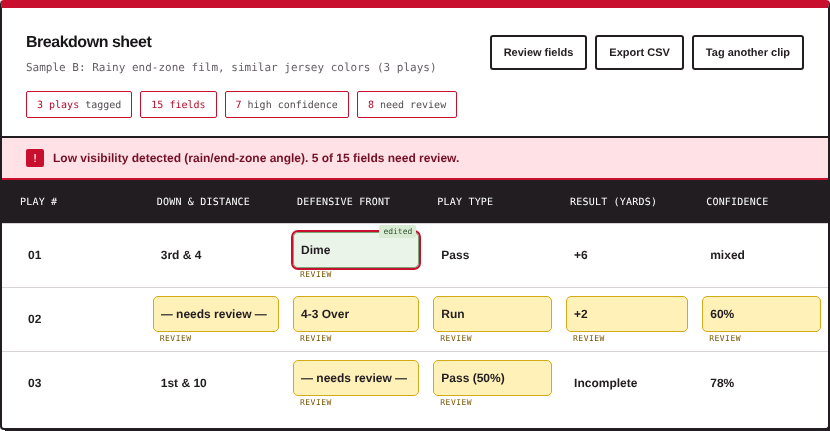
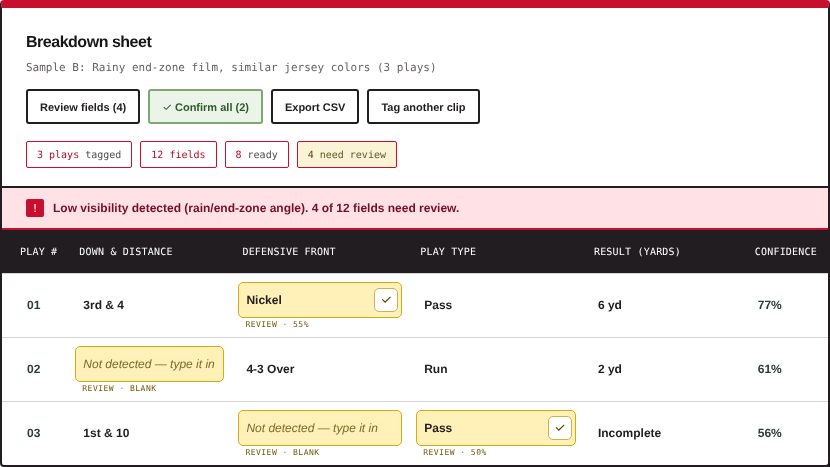

# BallHawk — Prototype Revision

This milestone revises the central task: **a coach runs a clip, BallHawk fills in the breakdown sheet, and the coach checks the uncertain fields before exporting.** All changes are based on peer review and on re-testing the first working slice.

- Original code (before revisions): commit [`13b1a09`](https://github.com/hschmit3-bit/GenAI-ESTEEM/commit/13b1a09)
- Revised code: commits [`6058e9c`](https://github.com/hschmit3-bit/GenAI-ESTEEM/commit/6058e9c) and [`d1d0fc4`](https://github.com/hschmit3-bit/GenAI-ESTEEM/commit/d1d0fc4)
- Main files: [`artifacts/ballhawk/src/App.tsx`](artifacts/ballhawk/src/App.tsx) (interface and review logic), [`artifacts/ballhawk/src/sampleData.json`](artifacts/ballhawk/src/sampleData.json) (scripted AI results)

---

## 1. Priority improvements

| # | Improvement | Why it was a priority |
|---|---|---|
| 1 | **One consistent review count.** A single rule now decides whether a field needs review. The summary, the low-visibility banner, the yellow cells, the Review button and the export check all use it. Only the four data fields count (Down & Distance, Formation, Play Type, Result). Confidence is now a read-only score. | Both peer reviewers saw the summary say **8** fields needed review while the banner said **5**. If the counts disagree, a coach can't tell how much checking is left, and can't trust the tool. |
| 2 | **A way to mark fields as reviewed, and to do it quickly.** Typing a correction marks a field reviewed. A **✓** on each yellow cell confirms a correct AI guess without retyping it. **✓ Confirm all** in the toolbar confirms every flagged field that has a value in one click. Blank fields still have to be typed in. | One reviewer pointed out that a corrected cell still said "edited REVIEW" and the count never went down. Coaches need to see what's left, and efficiency is the product's main value. |
| 3 | **Export check (risk safeguard).** If any fields are still unreviewed, Export CSV first warns how many are left, with **Review fields first** as the main button. The CSV now has a **Review status** column marking each row as `Reviewed`, `Unreviewed AI guess: …` or `Bulk-confirmed AI guess: …`. | The main risk is a coach exporting AI guesses as if they were checked data. See [section 5](#5-risk-response). |

**Small fixes found while testing:**
- The "Choose a clip" message was set in the code but never displayed. It now appears when no clip is chosen.
- Sample B's scripted results now give every field its own deliberate confidence score. Before, the score "mixed" silently skipped review, and one play's overall score spread onto every field.

## 2. How the AI works in this prototype

| | Status | Details |
|---|---|---|
| **AI task** | Planned | Watch each play and fill in Down & Distance, Formation (or Defensive Front), Play Type and Result, with a confidence score per field. |
| **Input** | Working | The coach picks Offense or Defense and a camera angle, then uploads a clip (.mp4/.mov/.webm) or picks a sample clip. |
| **Video analysis** | **Simulated (Wizard of Oz)** | No model watches the film. Each sample clip returns pre-written results from `sampleData.json`. An uploaded video shows Sample A's results with the label *"Demo results — live video analysis not yet connected."* |
| **Confidence scores** | **Simulated** | The scores are written into the sample data. Any field under 70%, or blank, is flagged for review. |
| **Output** | Working | One row per play, filled in one play at a time, then a breakdown sheet the coach can edit or confirm, and a CSV export. |
| **Review flow and export check** | Working | Real code, not simulated: the counts, the ✓ / Confirm all buttons, the export warning and the CSV Review status column. |
| **Value to the user** | Claimed, not yet proven | The coach reviews a mostly completed sheet instead of typing every field. Whether real AI can get about 90% of fields right on real film is still untested. |

**Implementation note:** I kept the AI simulated for this milestone on purpose. The revision targets the review experience around the AI's output, which can be tested honestly with scripted results. These tests do **not** show anything about model accuracy.

## 3. Response to peer feedback

I received two written reviews. Names are left out.

| Feedback or observed issue | Decision | What changed, or why it was deferred |
|---|---|---|
| The review count didn't match: the summary said 8 fields needed review, the banner said 5 of 15 (both reviewers). | **Acted on** | The banner was hard-coded text, and the summary counted the Confidence column as a field. One shared rule now drives every count. Sample B reads **4 of 12** everywhere and counts down as fields are reviewed. |
| After correcting a tag it still said "edited REVIEW," and there was no way to mark a field as reviewed. | **Acted on, then adapted** | Editing now clears the flag, and a ✓ confirms correct guesses. I added **Confirm all** for speed, because efficiency matters most to coaches. To keep the safeguard, Confirm all skips blank fields and labels its confirmations as bulk in the CSV. |
| "Review fields" jumping to the first uncertain tag, and editing directly in the sheet, were useful. | **Kept** | Unchanged. The Review button now also shows how many fields are left, for example *Review fields (4)*. |
| The prototype made it clear the analysis is simulated. | **Kept** | The "Local demo" chip and the uploaded-clip notice stay. |
| Wanted to see how it works on a brand-new clip. | **Deferred** | Real video analysis is out of scope for this milestone (the AI stays simulated). Uploading your own clip still runs the demo with a clear label. Testing showed that label isn't enough on its own (see the challenge case below), so making uploaded-clip results look less trustworthy is a next priority. |

## 4. Evaluation

All tests used the sample clips or a synthetic file, and ran on the revised build in Chrome. The AI output is scripted, so these tests check whether the **experience** is clear and useful. They say nothing about model accuracy.

| Case | Input or action | Expected result / success criterion | Actual result | Pass, partial, or fail | Implication or next step |
|---|---|---|---|---|---|
| **Typical 1** | Offense, Sideline, Sample A (clear day game, 3 plays), then Export CSV | All 12 fields filled with high confidence and 0 need review. Export downloads directly with no warning. Every CSV row says `Reviewed`. | 12 fields filled at 88–94%, "0 need review." Review fields and Confirm all are greyed out. CSV downloaded with no warning, and every row says `Reviewed`. | **Pass** | On clean film, the review step stays out of the coach's way. |
| **Typical 2** | Defense, End zone, Sample B (rain, similar jerseys). Type the 2 blank fields, ✓ the 2 low-confidence guesses, then export. | Summary, banner, button and yellow cells all show the same count. It drops with each fix, reaches 0, and the CSV says `Reviewed`. | All four places showed **4 of 12**, then 3, 2, 1, 0. The banner ended with "All 12 fields have been reviewed." No warning on export, and every row says `Reviewed`. | **Pass** | Fixes the main peer-review complaint. |
| **Challenge** | Upload your own clip (a synthetic `myclip.mp4`, not real game film), Offense, Unknown angle | Results are clearly labeled as a demo and don't look like a confident analysis of *this* clip. | Shows the filename and *"Demo results — live video analysis not yet connected,"* but then shows Sample A's results at **88–94% confidence** with "0 need review" and "All fields reviewed." | **Partial** | The label is there, but the confident scores and the "all reviewed" state undercut it. A coach skimming could believe their clip was analyzed. Next step: flag every field for review on uploaded clips. |
| **Invalid / empty** | (a) Click Tag Plays with nothing selected. (b) Upload `playbook.pdf`. (c) Pick Sample C (corrupted file). | (a) A message under each missing step. (b, c) A clear "couldn't read this clip" message with a one-click way forward. | (a) "Choose Offense or Defense," "Choose a camera angle," **"Choose a clip"** (this one never showed before the revision). (b, c) The "couldn't read this clip" message lists supported formats, and **Try a sample clip** selects Sample A. | **Pass** | Every missing input is now named. |
| **Risk** | Sample B with 4 fields unreviewed, click Export CSV. Then try *Export anyway*, and separately **Confirm all**. | The coach is stopped before exporting unchecked AI guesses, can go back to review, and any CSV exported anyway marks the unchecked values. | A warning appeared: "4 fields still need review," with **Review fields first** as the main button. *Export anyway* produced rows such as `Unreviewed AI guess: Defensive Front; Play Type`. **Confirm all** cleared the 2 flagged fields that had values, left the 2 blanks flagged, and marked its fields `Bulk-confirmed AI guess` in the CSV. | **Partial** | The safeguard works and stays honest in the export. But Confirm all lets a coach accept every remaining guess in one click without looking at the film. Blank fields and the bulk label reduce this risk without removing it. |

### Before and after: the review count (same input, same steps)

**Input:** Defense, End zone, Sample B, then correct Play 1's Defensive Front to "Dime."

| | Before (commit `13b1a09`) | After |
|---|---|---|
| Summary | 15 fields · **8 need review** | 12 fields · **4 need review** |
| Banner | "**5 of 15** fields need review" (hard-coded) | "**4 of 12** fields need review" (calculated) |
| After correcting one field | Still **8**. The cell shows both "edited" and "REVIEW." | **3** everywhere. The cell turns green and the tag clears. |
| Why | The banner was fixed text. The summary counted the Confidence column, spread one play's 60% score onto all of its fields, and couldn't read "mixed" as a number. | One shared rule, four data fields, and an explicit score for every field. |

| Before | After |
|---|---|
|  |  |

**Did it help?** Yes. Both reviewers' main complaint is gone: every count matches, and it goes down as the coach works. Their second complaint (no way to mark a field as reviewed) is also fixed.

More screenshots: [export check](docs/screenshots/after-export-check.png) · [uploaded-clip demo (challenge case)](docs/screenshots/after-own-clip.png) · [empty input, before](docs/screenshots/before-empty.png) and [after](docs/screenshots/after-empty.png)

### What does the evidence tell me?

The review flow now works reasonably well. On clean film it stays out of the way. On difficult film, every part of the page agrees on how much is left, the count goes down as the coach fixes or confirms fields, and nothing unchecked reaches the CSV without a label. What remains unreliable is everything behind the scripted data: the confidence scores, the 70% threshold and the tags themselves are written by hand, so these tests can't show that BallHawk reaches the ~90% per-field accuracy the product depends on. The challenge case also showed a clarity problem: an uploaded clip gets confident-looking demo results, which could mislead a coach despite the label. The results support the *experience* side of the value claim (reviewing a mostly filled sheet is fast and clear), but not the *accuracy* side. Next, I would run one real frame per play through a vision model for Formation and compare it with plays I tag by hand, and I would flag every field on uploaded clips until that's connected.

## 5. Risk response

**Risk: coaches relying on AI guesses they never checked.** The people affected are the assistant coach or graduate assistant doing the breakdown, the coordinators who build a game plan from it, and the players who are coached on that plan. If BallHawk mislabels a defensive front in rainy end-zone film and the coach exports without checking, the error becomes a "fact" in the opponent's tendency report. That leads to a bad scouting call. Small programs, the target users, have the fewest staff to catch it later.

**What I changed:** every place on the page shows the same count of what's left to review, so the remaining work is visible. Export now stops the coach while fields are unreviewed and makes **Review fields first** the main choice. If the coach exports anyway, the CSV's **Review status** column marks unreviewed and bulk-confirmed AI guesses, so whoever opens the spreadsheet later can tell checked data from unchecked data. **Confirm all** never fills in blank fields, which the coach still has to type.

**What risk remains:** Confirm all and *Export anyway* still let a coach accept everything in two clicks. I chose that trade-off on purpose, because the product only has value if it saves time. The Review status column can also be deleted once the CSV is opened elsewhere. And since the confidence scores are scripted, the flags only show where uncertainty *would* be marked, not whether a real model's scores would match its real errors. **Course theme:** over-reliance on AI, keeping a human in the loop and making AI output easy to tell apart from checked data. Related privacy point: game film can show minors, so the prototype never uploads video (the clip stays in the browser) and stores nothing.

## 6. Remaining limitations

Ranked by how much each one affects the central task:

1. **Video analysis is simulated.** The core accuracy question is still untested.
2. **Confidence scores and the 70% threshold are made up,** not calibrated against real model errors.
3. **Uploaded clips get confident demo results** (challenge case). The label alone doesn't stop a coach from trusting them.
4. **Confirm all lets a coach accept guesses in bulk** without watching the film. This is partly offset by the CSV label.
5. **No saved work and no Hudl workflow.** A breakdown is lost on refresh unless exported. Clips are uploaded instead of read next to Hudl (out of scope).

## 7. Next priorities

1. **Connect a real vision model for one field.** Send one frame per play to a vision model to classify Formation, then measure accuracy against 20–30 plays I tag by hand.
2. **Make uploaded-clip results clearly provisional.** Until analysis is live, start every field on an uploaded clip as "needs review."
3. **Let the coach check a tag against the film.** Add a timestamp and "jump to play" on each row, so confirming means actually looking at the play.
